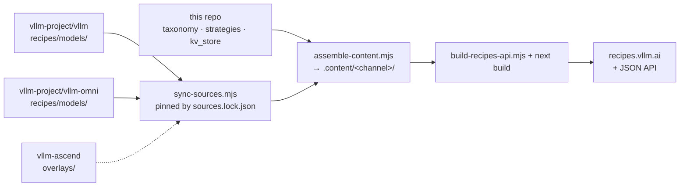

# [vLLM Recipes](https://recipes.vllm.ai/)

This repo intends to host community maintained common recipes to run vLLM answering the question:
**How do I run model X on hardware Y for task Z?**

## Guides

### Arcee AI 

- [Trinity-Large-Thinking](ArceeAI/Trinity-Large-Thinking.md)

### DeepSeek 

- [DeepSeek-OCR](DeepSeek/DeepSeek-OCR.md)
- [DeepSeek-V3.1](DeepSeek/DeepSeek-V3_1.md)
- [DeepSeek-V3, DeepSeek-R1](DeepSeek/DeepSeek-V3.md)
- [DeepSeek-V3.2-Exp](DeepSeek/DeepSeek-V3_2-Exp.md)
- [DeepSeek-V3.2](DeepSeek/DeepSeek-V3_2.md)


### Ernie 

- [Ernie4.5](Ernie/Ernie4.5.md)
- [Ernie4.5-VL](Ernie/Ernie4.5-VL.md)

### GLM 

- [GLM-5.1, GLM-5](GLM/GLM5.md)
- [Glyph](GLM/Glyph.md)
- [GLM-4.7-Flash, GLM-4.7, GLM-4.6, GLM-4.5, GLM-4.5-Air](GLM/GLM.md)
- [GLM-4.5V, GLM-4.6V](GLM/GLM-V.md)

### Google 

- [Gemma 4](Google/Gemma4.md)
- [TranslateGemma](Google/TranslateGemma.md)

### inclusionAI 

- [Ring-1T-FP8](inclusionAI/Ring-1T-FP8.md)

### InternVL 

- [InternVL3.5](InternVL/InternVL3_5.md)

### InternLM 

- [Intern-S1](InternLM/Intern-S1.md)

### Jina AI 

- [Jina-reranker-m0](Jina/Jina-reranker-m0.md)

### Llama

- [Llama4-Scout](Llama/Llama4-Scout.md)
- [Llama3.3-70B](Llama/Llama3.3-70B.md)
- [Llama3.1](Llama/Llama3.1.md)

### Microsoft 

- [Phi-4](Microsoft/Phi-4.md)

### MiniMax 

- [MiniMax-M2.7, MiniMax-M2.5, MiniMax-M2.1, MiniMax-M2](MiniMax/MiniMax-M2.md)

### Xiaomi MiMo 

- [MiMo-V2-Flash](MiMo/MiMo-V2-Flash.md)

### Mistral AI 

- [Ministral-3-Instruct](Mistral/Ministral-3-Instruct.md)
- [Ministral-3-Reasoning](Mistral/Ministral-3-Reasoning.md)
- [Mistral-Large-3-Instruct](Mistral/Mistral-Large-3.md)

### Moonshotai 

- [Kimi-K2.5](moonshotai/Kimi-K2.5.md)
- [Kimi-K2](moonshotai/Kimi-K2.md)
- [Kimi-K2-Think](moonshotai/Kimi-K2-Think.md)
- [Kimi-Linear](moonshotai/Kimi-Linear.md)

### NVIDIA

- [Nemotron-3-Nano-30B-A3B](NVIDIA/Nemotron-3-Nano-30B-A3B.md)
- [Nemotron-Nano-12B-v2-VL](NVIDIA/Nemotron-Nano-12B-v2-VL.md)

### OpenAI 

- [gpt-oss](OpenAI/GPT-OSS.md)

### PaddlePaddle 

- [PaddleOCR-VL](PaddlePaddle/PaddleOCR-VL.md)

### Qwen 

- [Qwen3](Qwen/Qwen3.md)
- [Qwen3-ASR](Qwen/Qwen3-ASR.md)
- [Qwen3-VL](Qwen/Qwen3-VL.md)
- [Qwen3-Next](Qwen/Qwen3-Next.md)
- [Qwen3.5](Qwen/Qwen3.5.md)
- [Qwen3-Coder-480B-A35B](Qwen/Qwen3-Coder-480B-A35B.md)
- [Qwen2.5-VL](Qwen/Qwen2.5-VL.md)
- [Qwen3Guard-Gen](Qwen/Qwen3Guard-Gen.md)
  
### Seed 

- [Seed-OSS-36B](Seed/Seed-OSS-36B.md)


### StepFun 

- [Step-3.5-Flash](StepFun/Step-3.5-Flash.md)


### Tencent-Hunyuan 

- [HunyuanOCR](Tencent-Hunyuan/HunyuanOCR.md)

## How recipes are maintained

Each recipe is a structured YAML file at `models/<hf_org>/<hf_repo>.yaml`, kept in the repository of the project that knows the model best. This repository is the **renderer**: it pulls those files in, merges them, and builds [recipes.vllm.ai](https://recipes.vllm.ai/) and its JSON API.



| Content | Where it lives | Status |
| --- | --- | --- |
| Model recipes served by vLLM | [`vllm-project/vllm` → `recipes/models/`](https://github.com/vllm-project/vllm/tree/main/recipes) | Owned by vLLM; a merge there reaches recipes.vllm.ai in about 30 minutes. Copies stay in this repo's `models/` until they are synced to vLLM and removed; they aren't rendered |
| Omni recipes (image, video, audio generation) | [`vllm-project/vllm-omni` → `recipes/models/`](https://github.com/vllm-project/vllm-omni/tree/main/recipes/models) | Owned by vLLM-Omni, reaching recipes.vllm.ai the same way. Copies stay in this repo's `models/` until they are removed; they aren't rendered |
| Ascend NPU content | Inline in the vLLM recipes | Moving to `overlays/` in vllm-ascend |
| Schema, hardware profiles, serving strategies, KV-store deployments, platforms | This repo (`taxonomy.yaml`, `strategies/`, `kv_store/`, `platforms.yaml`) | Owned here |
| Command synthesis, site, JSON API | This repo (`src/`, `scripts/`) | Owned here |

How the pieces fit:

- **[`sources.yaml`](https://github.com/vllm-project/recipes/blob/main/sources.yaml)** lists every source repository for a *channel* (today only `latest`). For each source it gives the repo, ref, and directory, a role, and the scope this repo grants it:
  - **core / owner** sources ship whole recipes. Each Hugging Face ID may come from only one source.
  - **overlay** sources add content to another source's recipe, for example Ascend profiles, variants, and overrides from vllm-ascend. An overlay can only *add* keys, and only for the hardware brands its scope grants, so it can never change what the NVIDIA or AMD commands render.
- **[`sources.lock.json`](https://github.com/vllm-project/recipes/blob/main/sources.lock.json)** pins every remote source to a commit, so each build is reproducible.
- **Updates are automatic.** [`bump-sources.yml`](https://github.com/vllm-project/recipes/blob/main/.github/workflows/bump-sources.yml) runs every 20 minutes:
  1. Checks whether a source's recipe directory changed.
  2. Validates the new content with the full JSON API build.
  3. Commits the lock, which redeploys the site.

  If validation fails, the lock stays on the last good commit, so the site keeps serving the previous content, and a `sources-bump-failed` issue is opened. There is one issue per failure, not one per run, and it closes itself on the next successful run.
- **Provenance.** Every recipe page links "Edit recipe" to the repository that owns the file. Every recipe JSON carries a `source` field (repo, commit, path) for tracing a command back to its YAML.

## Contributing

Edit or add a recipe in the repository that owns it (see the table above), following **[CONTRIBUTING.md](CONTRIBUTING.md)** for the full schema, VRAM formula, and validation steps. Changes to the schema, hardware profiles, strategies, or the site go to this repository.

To preview a recipe change from a local checkout of a source repository, create a gitignored `sources.local.yaml` in this repo:

```yaml
overrides:
  vllm: ~/vllm/recipes
  vllm-omni: ~/vllm-omni/recipes
```

Quick loop:

```bash
pnpm install
pnpm dev                              # http://localhost:3000
node scripts/sync-sources.mjs         # fetch the source commits pinned in sources.lock.json
node scripts/build-recipes-api.mjs    # assembles sources, validates every YAML, rebuilds the JSON API
node scripts/validate-source.mjs --source vllm --dir ~/vllm/recipes   # validate a source checkout (what its CI runs)
pnpm content:watch                    # re-assemble when files are added to or removed from a local source
```

### Legacy MkDocs guides

The top-level Markdown directories (`DeepSeek/`, `Qwen/`, etc.) are the historical MkDocs site, kept as a reference during the YAML migration. To preview them:

```bash
uv venv
source .venv/bin/activate
uv pip install -r requirements.txt
uv run mkdocs serve --dev-addr 127.0.0.1:8001
```

## License

This project is licensed under the Apache License 2.0 - see the [LICENSE](https://github.com/vllm-project/recipes/blob/main/LICENSE) file for details.
