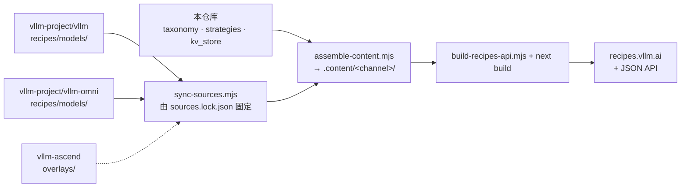

# [vLLM Recipes](https://recipes.vllm.ai/)

[ [English](README.md) | 简体中文 ]

本仓库旨在收录由社区维护的常用 vLLM 运行方案（Recipes），解答以下核心问题：
**如何在硬件 Y 上运行模型 X 以完成任务 Z？**

## 指南 (Guides)

### Arcee AI 

- [Trinity-Large-Thinking](ArceeAI/Trinity-Large-Thinking.md)

### DeepSeek 

- [DeepSeek-OCR](DeepSeek/DeepSeek-OCR.md)
- [DeepSeek-V3.1](DeepSeek/DeepSeek-V3_1.md)
- [DeepSeek-V3, DeepSeek-R1](DeepSeek/DeepSeek-V3.md)
- [DeepSeek-V3.2-Exp](DeepSeek/DeepSeek-V3_2-Exp.md)
- [DeepSeek-V3.2](DeepSeek/DeepSeek-V3_2.md)

### Ernie 

- [Ernie4.5](Ernie/Ernie4.5.md)
- [Ernie4.5-VL](Ernie/Ernie4.5-VL.md)

### GLM 

- [GLM-5.1, GLM-5](GLM/GLM5.md)
- [Glyph](GLM/Glyph.md)
- [GLM-4.7-Flash, GLM-4.7, GLM-4.6, GLM-4.5, GLM-4.5-Air](GLM/GLM.md)
- [GLM-4.5V, GLM-4.6V](GLM/GLM-V.md)

### Google 

- [Gemma 4](Google/Gemma4.md)
- [TranslateGemma](Google/TranslateGemma.md)

### inclusionAI 

- [Ring-1T-FP8](inclusionAI/Ring-1T-FP8.md)

### InternVL 

- [InternVL3.5](InternVL/InternVL3_5.md)

### InternLM 

- [Intern-S1](InternLM/Intern-S1.md)

### Jina AI 

- [Jina-reranker-m0](Jina/Jina-reranker-m0.md)

### Llama

- [Llama4-Scout](Llama/Llama4-Scout.md)
- [Llama3.3-70B](Llama/Llama3.3-70B.md)
- [Llama3.1](Llama/Llama3.1.md)

### Microsoft 

- [Phi-4](Microsoft/Phi-4.md)

### MiniMax 

- [MiniMax-M2.7, MiniMax-M2.5, MiniMax-M2.1, MiniMax-M2](MiniMax/MiniMax-M2.md)

### Xiaomi MiMo 

- [MiMo-V2-Flash](MiMo/MiMo-V2-Flash.md)

### Mistral AI 

- [Ministral-3-Instruct](Mistral/Ministral-3-Instruct.md)
- [Ministral-3-Reasoning](Mistral/Ministral-3-Reasoning.md)
- [Mistral-Large-3-Instruct](Mistral/Mistral-Large-3.md)

### Moonshotai 

- [Kimi-K2.5](moonshotai/Kimi-K2.5.md)
- [Kimi-K2](moonshotai/Kimi-K2.md)
- [Kimi-K2-Think](moonshotai/Kimi-K2-Think.md)
- [Kimi-Linear](moonshotai/Kimi-Linear.md)

### NVIDIA

- [Nemotron-3-Nano-30B-A3B](NVIDIA/Nemotron-3-Nano-30B-A3B.md)
- [Nemotron-Nano-12B-v2-VL](NVIDIA/Nemotron-Nano-12B-v2-VL.md)

### OpenAI 

- [gpt-oss](OpenAI/GPT-OSS.md)

### PaddlePaddle 

- [PaddleOCR-VL](PaddlePaddle/PaddleOCR-VL.md)

### Qwen 

- [Qwen3](Qwen/Qwen3.md)
- [Qwen3-ASR](Qwen/Qwen3-ASR.md)
- [Qwen3-VL](Qwen/Qwen3-VL.md)
- [Qwen3-Next](Qwen/Qwen3-Next.md)
- [Qwen3.5](Qwen/Qwen3.5.md)
- [Qwen3-Coder-480B-A35B](Qwen/Qwen3-Coder-480B-A35B.md)
- [Qwen2.5-VL](Qwen/Qwen2.5-VL.md)
- [Qwen3Guard-Gen](Qwen/Qwen3Guard-Gen.md)

### Seed 

- [Seed-OSS-36B](Seed/Seed-OSS-36B.md)

### StepFun 

- [Step-3.5-Flash](StepFun/Step-3.5-Flash.md)

### Tencent-Hunyuan 

- [HunyuanOCR](Tencent-Hunyuan/HunyuanOCR.md)

## Recipes 维护机制

每个 Recipe 都是位于 `models/<hf_org>/<hf_repo>.yaml` 的结构化 YAML 文件，存放在对该模型最了解的对应项目仓库中。本仓库充当**渲染器（renderer）**：拉取这些文件、进行合并，并构建 [recipes.vllm.ai](https://recipes.vllm.ai/) 及其 JSON API。



| 内容 (Content) | 存放位置 (Where it lives) | 状态与归属 (Status) |
| --- | --- | --- |
| 由 vLLM 提供服务的模型 Recipe | [`vllm-project/vllm` → `recipes/models/`](https://github.com/vllm-project/vllm/tree/main/recipes) | 归 vLLM 所有；在该仓库合并后约 30 分钟同步至 recipes.vllm.ai。在同步至 vLLM 并清理前，副本会暂存在本仓库的 `models/` 中；它们不会被渲染 |
| Omni Recipes（图像、视频、音频生成） | [`vllm-project/vllm-omni` → `recipes/models/`](https://github.com/vllm-project/vllm-omni/tree/main/recipes/models) | 归 vLLM-Omni 所有，以相同方式同步至 recipes.vllm.ai。副本会暂存在本仓库的 `models/` 中直到清理；它们不会被渲染 |
| 昇腾 (Ascend) NPU 内容 | [`vllm-project/vllm-ascend` → `recipes/overlays/`](https://github.com/vllm-project/vllm-ascend/tree/main/recipes/overlays) | 归 vLLM Ascend 所有；合并至 vLLM recipes 中（vLLM 主仓库上游源不包含华为硬件配置） |
| Schema 规范、硬件配置规格、Serving 策略、KV-store 部署配置、平台列表 | 本仓库 (`taxonomy.yaml`, `strategies/`, `kv_store/`, `platforms.yaml`) | 由本仓库维护与管理 |
| 命令合成 (Command synthesis)、站点及 JSON API | 本仓库 (`src/`, `scripts/`) | 由本仓库维护与管理 |

各组件协同工作机制：

- **[`sources.yaml`](https://github.com/vllm-project/recipes/blob/main/sources.yaml)** 列出了特定*渠道*（channel，当前仅为 `latest`）的所有源仓库。对于每个数据源，它指定了对应的仓库 (repo)、引用分支/标签 (ref)、目录 (directory)、角色 (role) 以及本仓库赋予它的作用域 (scope)：
  - **核心 / 所有者 (core / owner)** 源提供完整的 Recipe。每个 Hugging Face ID 只能来自于单一数据源。
  - **覆盖 (overlay)** 源为其他数据源的 Recipe 增补内容，例如来自 vllm-ascend 的 Ascend 硬件配置、变体与覆盖规则。覆盖源只能*添加*键值，且仅限于其作用域所授权的硬件品牌，因此绝不会影响 NVIDIA 或 AMD 命令的渲染生成。
- **[`sources.lock.json`](https://github.com/vllm-project/recipes/blob/main/sources.lock.json)** 将每个远程数据源锁定在特定的 commit 上，从而保证每次构建的完全可复现。
- **全自动更新**。[`bump-sources.yml`](https://github.com/vllm-project/recipes/blob/main/.github/workflows/bump-sources.yml) 工作流每 20 分钟执行一次：
  1. 检查各数据源的 recipe 目录是否有更新。
  2. 运行完整的 JSON API 构建以验证新内容。
  3. 提交 lock 锁文件更新，从而触发站点的重新部署。

  若验证失败，lock 文件将保持在最近一次正常的 commit，使站点继续提供此前正常的内容，并自动创建一个 `sources-bump-failed` issue。每次失败只会存在一个 issue，而非每次执行都重复创建，并在下一次成功运行时自动关闭。
- **溯源追踪 (Provenance)**。每个 Recipe 页面上的 "Edit recipe" 均直接链接到拥有该文件的源仓库。每个 Recipe JSON 都包含一个 `source` 字段（包括 repo、commit、path），以便将生成的命令行精准回溯到其对应的 YAML 原始定义。

## 参与贡献

在拥有该 Recipe 的源仓库中编辑或添加 Recipe（参见上表），并遵循 **[CONTRIBUTING.md](CONTRIBUTING.md)** 中的完整 schema 规范、显存 (VRAM) 计算公式与验证流程。对 schema 规范、硬件规格配置、策略或站点本身的修改请直接提交至本仓库。

如需从本地检出的源仓库预览 Recipe 修改，可在本仓库中创建一个被 git 忽略的 `sources.local.yaml` 文件：

```yaml
overrides:
  vllm: ~/vllm/recipes
  vllm-omni: ~/vllm-omni/recipes
```

快速开发工作流：

```bash
pnpm install
pnpm dev                              # http://localhost:3000
node scripts/sync-sources.mjs         # 拉取 sources.lock.json 中锁定的源 commit
node scripts/build-recipes-api.mjs    # 组装数据源，校验所有 YAML，重新构建 JSON API
node scripts/validate-source.mjs --source vllm --dir ~/vllm/recipes   # 校验本地检出的数据源（与其 CI 执行逻辑一致）
pnpm content:watch                    # 当本地源中增删文件时自动重新组装内容
```

### 历史 MkDocs 指南 (Legacy MkDocs guides)

顶层 Markdown 目录（如 `DeepSeek/`、`Qwen/` 等）属于历史 MkDocs 站点，在 YAML 迁移过程中作为参考保留。如需本地预览：

```bash
uv venv
source .venv/bin/activate
uv pip install -r requirements.txt
uv run mkdocs serve --dev-addr 127.0.0.1:8001
```

## 许可证 (License)

本项目基于 Apache License 2.0 许可证开源 - 详见 [LICENSE](https://github.com/vllm-project/recipes/blob/main/LICENSE) 文件。

---

> **免责声明**：本文档由社区志愿者维护与翻译。如翻译内容与英文原文存在出入，请以英文原版为准。
